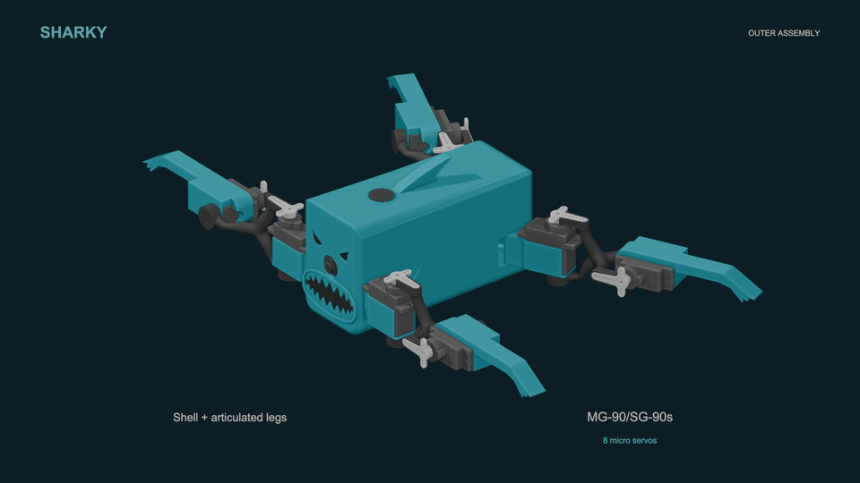

  

  A compact Raspberry Pi and ROS 2 quadruped built for understandable hardware,
  cautious experimentation, and a lot of character.

  <a href="#start-here">Start here</a> ·
  <a href="docs/HARDWARE.md">Hardware</a> ·
  <a href="docs/SETUP.md">Setup</a> ·
  <a href="docs/SAFETY.md">Safety</a> ·
  <a href="assets/exploded/sharky-exploded.mp4">Exploded-view video</a>

## Meet SHARKY

SHARKY is a small eight-servo quadruped with a Raspberry Pi brain, a PCA9685
servo controller, a camera, and a deliberately simple crawl gait. This release
collects the printable/CAD-derived robot geometry, ROS 2 control software,
example configuration, and visual assets in one place.

The repository is designed to be safe to inspect and build offline. Cloning or
building it **does not move a robot**. Hardware motion requires all of the
following: a wired servo controller, a running hardware driver, the SHARKY
motion stack, and an explicit arm command.

## Exploded view

  

Click the animation for the [full 1080p MP4](assets/exploded/sharky-exploded.mp4).
The [4K component board](assets/exploded/sharky-core-components.png) is also
included for a closer look.

## What's in the repository

| Path | Contents |
| --- | --- |
| [`hardware/urdf`](hardware/urdf) | Fusion exports, STL meshes, Xacro work, and joint audit data |
| [`hardware/fusion_tools`](hardware/fusion_tools) | Fusion 360 helpers used to audit and configure the assembly |
| [`software/sharky_control`](software/sharky_control) | ROS 2 motion, gait, camera, and local dashboard package |
| [`software/ros2_pca9685`](software/ros2_pca9685) | Vendored PCA9685 ROS 2 driver (BSD-3-Clause) |
| [`config`](config) | Safe example environment and bounded crawl-gait profile |
| [`assets`](assets) | Header art and exploded-view media |
| [`docs`](docs) | Build, setup, safety, and privacy notes |

> [!NOTE]
> The exported `Quadruped.xacro` is a work in progress. The meshes and joint
> audit are useful, but the model still needs regeneration from the saved
> eight-joint Fusion assembly before it should be treated as a complete URDF.

## Start here

1. Read the [hardware overview](docs/HARDWARE.md) and source equivalent parts.
2. Assemble the frame with power disconnected and verify every linkage by hand.
3. Install a supported ROS 2 distribution on the Raspberry Pi.
4. Follow the [software setup](docs/SETUP.md) to build the workspace.
5. Keep the robot raised clear of the floor for first power-on.
6. Verify the servo channel map and limits for **your** assembly before arming.

The supplied gait controller starts disarmed, applies immutable per-channel
angle envelopes, and includes a motion-command watchdog. Those safeguards are
helpful, but they cannot compensate for an incorrect servo horn, reversed joint,
miswired power rail, or unsuitable battery system.

## A safe first session

Build and inspect first; do not launch the hardware stack while assembling.
When you are ready for a powered check, disconnect the servo power, start ROS,
confirm that the expected nodes and services appear, then shut down again. Only
after the mechanical and electrical checks in [SAFETY.md](docs/SAFETY.md) should
you reconnect servo power and perform a restrained, raised test.

## Privacy

This public release intentionally contains no passwords, private network names,
IP addresses, machine usernames, SSH targets, device images, tokens, or personal
filesystem paths. Configure your own values locally from
[`config/sharky.env.example`](config/sharky.env.example), and never commit the
resulting private environment file.

## Project status

SHARKY is an active experimental platform, not a consumer product or a finished
reference design. Expect to validate dimensions, electrical ratings, joint
directions, and software limits against your own build.

## Licensing

The vendored `ros2_pca9685` package retains its BSD-3-Clause licence. No licence
is granted for the remaining project-original material in this snapshot; see
[`NOTICE.md`](NOTICE.md) before redistributing or adapting it.
