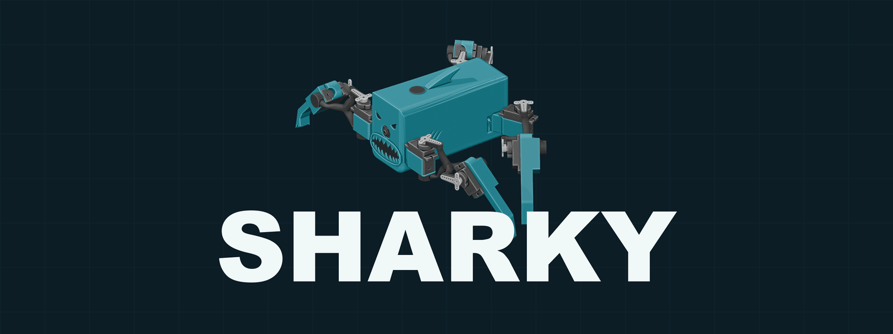
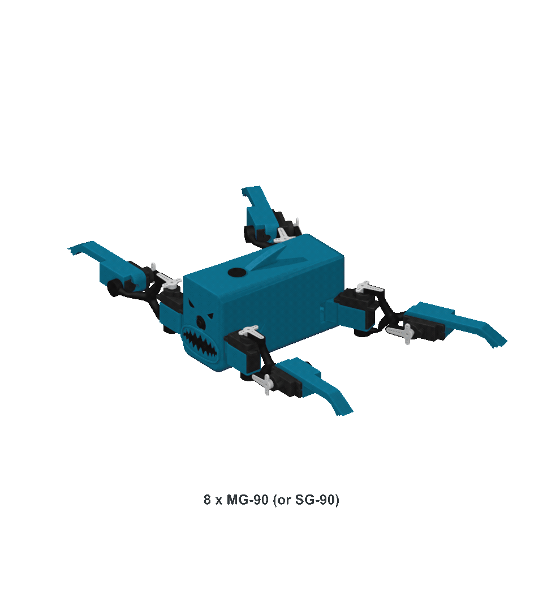

  

  SHARKY is a compact Raspberry Pi quadruped with eight articulated servos,
  live camera vision, a browser controller, and a whole lot of bite.

  <a href="parts/stl"><strong>Download the STLs</strong></a> ·
  <a href="docs/BUILD.md"><strong>Build and wire SHARKY</strong></a> ·
  <a href="docs/SETUP.md"><strong>Set up the Pi + ROS 2</strong></a> ·
  <a href="docs/HARDWARE.md"><strong>See the hardware</strong></a>

  

## A robot you can make your own

SHARKY combines printable mechanical parts with a focused ROS 2 control stack.
The motion controller drives a smooth crawl gait, the camera streams a live
view, and the lightweight dashboard puts movement, speed, pose, and individual
servo testing in the browser.

| Print | Build | Code | Control |
| --- | --- | --- | --- |
| Nine Fusion fabrication STLs | Raspberry Pi Zero 2 W + PCA9685 + eight servos | Python and C++ ROS 2 packages | Responsive local web dashboard |

## Everything you need to get started

- [`parts/stl`](parts/stl) — the full printable body set, exported from Fusion
- [`software/sharky_control`](software/sharky_control) — gait, motion, camera, and dashboard
- [`software/ros2_pca9685`](software/ros2_pca9685) — ROS 2 servo-driver package
- [`config`](config) — bounded crawl-gait profile and local configuration template

## Build SHARKY

1. [Download and print the nine fabrication files](parts/stl).
2. [Assemble and wire the body, servos, controller, Pi, and camera](docs/BUILD.md).
3. [Install Ubuntu and ROS 2 on the Pi](docs/SETUP.md).
4. Build the SHARKY workspace and launch the dashboard.
5. Take it further, build an attachment, test and algorithm - enjoy! 

The full build guide targets **Ubuntu Server 24.04 LTS arm64** and
**ROS 2 Jazzy** on a Raspberry Pi Zero 2 W.

## Licence

SHARKY's original code, printable parts, documentation, and media are licensed
under [CC BY-NC 4.0](LICENSE): sharing and adaptation are welcome with
attribution, but commercial use is not permitted. The vendored
`ros2_pca9685` package retains its BSD-3-Clause licence. See
[`NOTICE.md`](NOTICE.md) for scope and attribution details.
