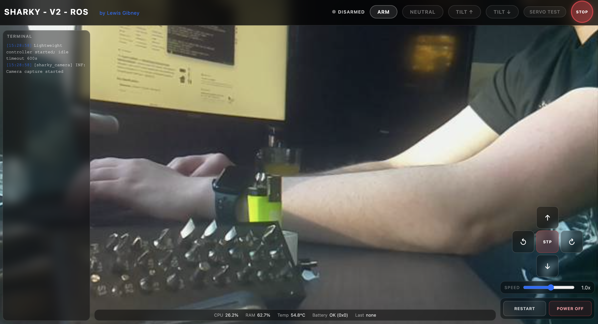
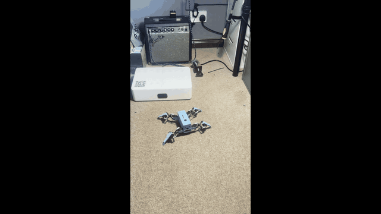

  

  SHARKY is a cheap and compact ROS2 quadruped with eight servos,
  live FPV camera vision and a web browser controller.

  <a href="parts/stl"><strong>Download the STLs</strong></a> ·
  <a href="docs/BUILD.md"><strong>Build and wire SHARKY</strong></a> ·
  <a href="docs/SETUP.md"><strong>Set up the Pi + ROS 2</strong></a> ·
  <a href="docs/HARDWARE.md"><strong>See the hardware</strong></a>

  

## Get started

- [`parts/stl`](parts/stl) — the full printable body set
- [`software/sharky_control`](software/sharky_control) — gait, motion, camera, and dashboard
- [`software/ros2_pca9685`](software/ros2_pca9685) — ROS 2 servo-driver package
- [`config`](config) — bounded crawl-gait profile and local configuration template

## Build SHARKY

1. [Download and print the nine fabrication files](parts/stl).
2. [Assemble and wire the body, servos, controller, Pi, and camera](docs/BUILD.md).
3. [Install Ubuntu and ROS 2 on the Pi](docs/SETUP.md).
4. Build the SHARKY workspace and launch the dashboard.
5. Take it further, build an attachment, test and algorithm - enjoy! 

## A robot you can make your own

SHARKY was built to be extensible. Feel free to make your own attachments to connect through the top hole! Start with the attachment connecter or produce your own mount!

## Demo

<table>
  <tr>
    <td width="50%">
      
    </td>
    <td width="50%">
      
    </td>
  </tr>
  <tr>
    <td align="center"><strong>Live browser dashboard</strong></td>
    <td align="center"><strong>Walking demo — select to play the full video</strong></td>
  </tr>
</table>

## Licence

SHARKY's original code, printable parts, documentation, and media are licensed
under [CC BY-NC 4.0](LICENSE): sharing and adaptation are welcome with
attribution, but commercial use is not permitted. The vendored
`ros2_pca9685` package retains its BSD-3-Clause licence. See
[`NOTICE.md`](NOTICE.md) for scope and attribution details.
