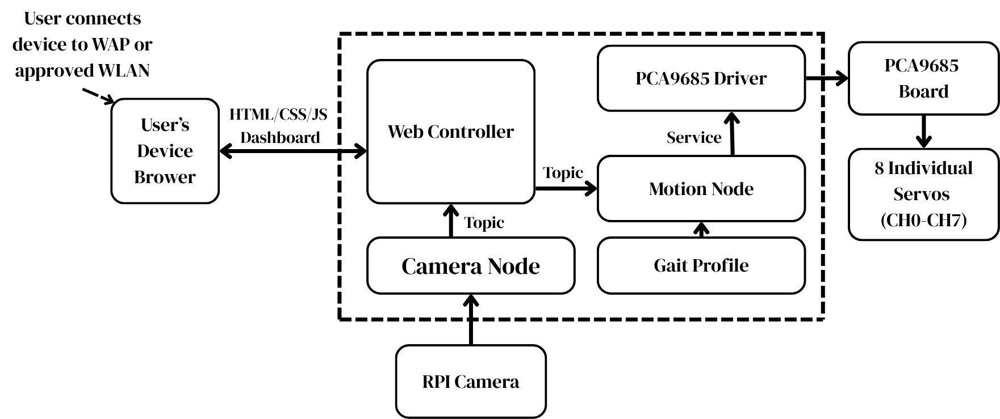
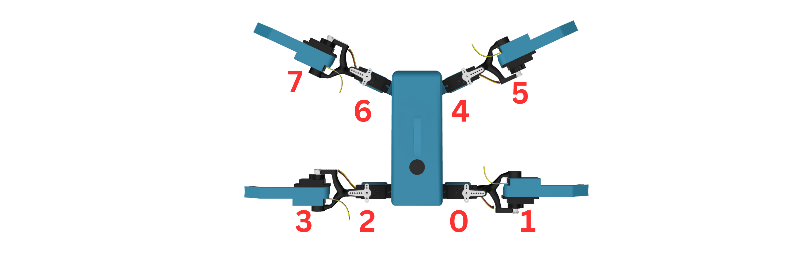

# Build and wiring

This guide brings together SHARKY's system layout, electrical connections, and
servo-channel positions. Use it alongside the [hardware overview](HARDWARE.md)
and [Raspberry Pi + ROS 2 setup guide](SETUP.md).

## System architecture

The diagram shows the high-level flow from the browser dashboard through the
Raspberry Pi control software to the PCA9685 board and eight servos.

## Wiring

The installed SHARKY build uses a **Pololu U3V40F5 5 V step-up regulator** in
place of the pictured XL6019-compatible module. Match the terminal names on the
actual modules before making connections.

The illustration shows the intended two-cell parallel pack and TP4056 charging
module. Confirm cell matching, battery protection, and the terminal layout of
the particular TP4056 board used in the build.

The Raspberry Pi to PCA9685 logic connections are:

| Raspberry Pi Zero 2 W | PCA9685 |
| --- | --- |
| Physical pin 1 — 3.3 V | VCC |
| Physical pin 3 — GPIO2 / SDA | SDA |
| Physical pin 5 — GPIO3 / SCL | SCL |
| Physical pin 6 — GND | GND |

The converter's regulated 5 V output connects to Raspberry Pi physical pin 4,
with its ground connected to physical pin 6. The PCA9685 servo supply uses its
separate V+ and GND terminal, while every board shares a common ground.

## Servo channel map

The channel numbers in the illustration correspond to the controller mapping:

| Channel | Servo position |
| ---: | --- |
| 0 | Front-left shoulder / rotation |
| 1 | Front-left knuckle / foot |
| 2 | Front-right shoulder / rotation |
| 3 | Front-right knuckle / foot |
| 4 | Rear-left shoulder / rotation |
| 5 | Rear-left knuckle / foot |
| 6 | Rear-right shoulder / rotation |
| 7 | Rear-right knuckle / foot |

Connect each servo plug to its assigned PCA9685 channel with the signal,
positive, and ground conductors aligned to the board's `S`, `V+`, and `GND`
rows.

## Build sequence

1. Print the files under [`parts/stl`](../parts/stl) and prepare four legs and
   four knuckles.
2. Install the eight servos using the channel map above before closing the
   shell.
3. Mount the battery pack, switch, fuse, regulator, PCA9685, Raspberry Pi, and
   camera on the internal electronics holder.
4. Make the power and signal connections shown in the wiring diagram.
5. Continue with the [Pi and ROS 2 setup](SETUP.md), then install the gait
   profile and launch SHARKY.
