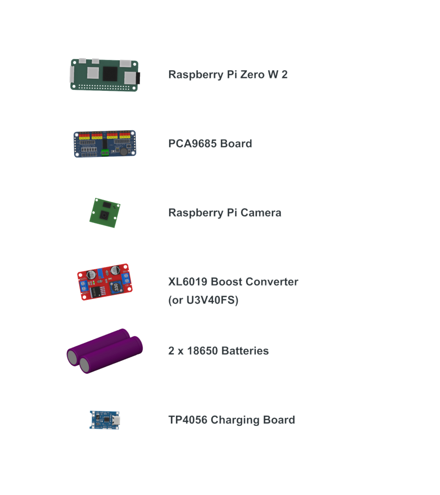

# Hardware overview

The illustrated build uses:

- Raspberry Pi Zero 2 W
- PCA9685 16-channel PWM/servo controller
- eight micro servos
- Raspberry Pi-compatible camera
- regulated servo power stage and a separate, appropriate Pi supply
- fabricated body, four upper legs, and four feet

The image is an exploded presentation, not a wiring diagram. Components are
shown at a common illustrative scale and substitutions require fresh electrical
and mechanical checks.

## Geometry and parts

The printable geometry is supplied directly as millimetre-scale STL files under
[`parts/stl`](../parts/stl). These are the actual Fusion body exports, separated
from simulation metadata and renamed by their physical position on the robot.
The body is approximately 120 mm long, which provides a useful scale check when
the file is first imported into a slicer.

Print one of each file:

| Files | Position |
| --- | --- |
| `body.stl` | Main chassis and shell |
| `front-left-leg.stl` / `front-left-foot.stl` | Front left |
| `front-right-leg.stl` / `front-right-foot.stl` | Front right |
| `rear-left-leg.stl` / `rear-left-foot.stl` | Rear left |
| `rear-right-leg.stl` / `rear-right-foot.stl` | Rear right |

Open the models in your slicer and inspect every layer before printing. Printer
tolerances, servo variants, screw selection, material, wall count, infill, and
support needs remain build-specific.

## Electrical caution

Servos can draw large transient currents. Do not power them from the Raspberry
Pi's regulator or assume a board's printed current rating applies without
cooling, wire, connector, and battery checks. Use a fuse, correct polarity,
shared signal ground, strain relief, and an accessible physical power cut-off.

Lithium cells can cause fire or injury if selected, charged, protected, or
wired incorrectly. Use a battery pack and charger designed for the exact cell
configuration, or seek review from someone qualified to assess the power design.
