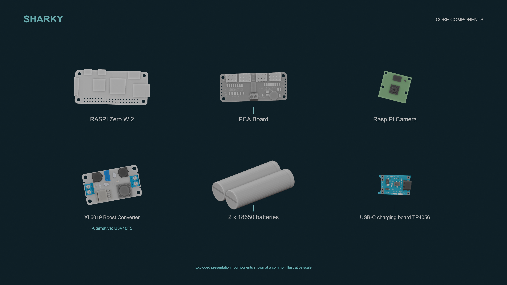

# Hardware overview

The illustrated build uses:

- Raspberry Pi Zero 2 W
- PCA9685 16-channel PWM/servo controller
- eight micro servos
- Raspberry Pi-compatible camera
- regulated servo power stage and a separate, appropriate Pi supply
- fabricated body, four upper legs, and four feet

The image is an exploded presentation, not a wiring diagram. Components are
shown at a common illustrative scale and substitutions require fresh electrical
and mechanical checks.

## Geometry and parts

STL meshes are under [`hardware/urdf/fusion_export`](../hardware/urdf/fusion_export).
The Fusion audit files record the intended component transforms and eight named
revolute joints. The current exported Xacro predates the final joint assembly,
so regenerate and validate the model before simulation or control work.

Expected leg naming, assuming Fusion +X is forward and +Y is left:

| CAD component | Position |
| --- | --- |
| `LegL1_1_1` / `FootL1_1_1` | Front left |
| `LegR1_1_1` / `FootR1_1_1` | Front right |
| `LegL2_1_1` / `FootL2_1_1` | Rear left |
| `LegR2_1_1` / `FootR2_1_1` | Rear right |

## Electrical caution

Servos can draw large transient currents. Do not power them from the Raspberry
Pi's regulator or assume a board's printed current rating applies without
cooling, wire, connector, and battery checks. Use a fuse, correct polarity,
shared signal ground, strain relief, and an accessible physical power cut-off.

Lithium cells can cause fire or injury if selected, charged, protected, or
wired incorrectly. Use a battery pack and charger designed for the exact cell
configuration, or seek review from someone qualified to assess the power design.
