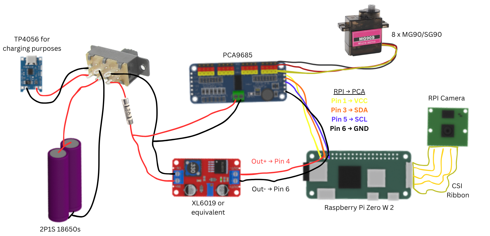

# Hardware overview

## Wiring Diagram

For the system architecture, electrical layout, and numbered servo positions,
see the [build and wiring guide](BUILD.md).

## Geometry and parts

The printable geometry is supplied directly as millimetre-scale STL files under
[`parts/stl`](../parts/stl). These are high-resolution exports from the full
Fusion assembly, not the simplified visualisation meshes. The main body is
approximately 121 mm long, which provides a useful scale check when the file is
first imported into a slicer.

Print four legs, four knuckles, and one of every other file. The eye-insert file
already contains the left and right pieces.

| File | Purpose |
| --- | --- |
| `main-body.stl` | Main shell and servo mounting structure |
| `internal-electronics-holder.stl` | Internal Pi, power, and controller carrier |
| `lid.stl` | Top lid and dorsal-fin detail |
| `leg.stl` | Lower leg; print four |
| `knuckle.stl` | Servo knuckle; print four |
| `eye-inserts.stl` | Left and right eye inserts |
| `mouth-insert.stl` | Toothed mouth detail |
| `blow-hole.stl` | Blow-hole cap |
| `rear-cover.stl` | Rear connector cover |

Open the models in your slicer and inspect every layer before printing. Printer
tolerances, servo variants, screw selection, material, wall count, infill, and
support needs remain build-specific.
